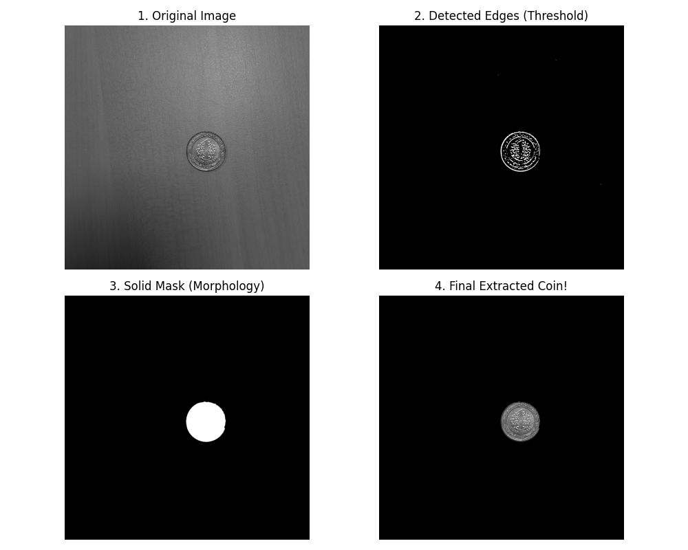
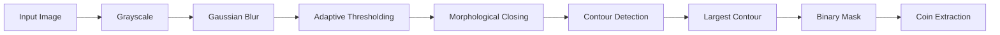

<div align="center">

# 🪙 Automated Coin Detection and Extraction

### Image Processing Pipeline using Python & OpenCV

**LEEN350 — Image Processing and Lab**

A computer vision project designed to automatically detect, segment, and extract a coin from a textured background under challenging lighting conditions.

**Ahmed Mahmoud Bahagat Abdelmoula**  
Student ID: **220303923**  
Istanbul Arel University — Faculty of Engineering

</div>

---

## 📌 Project Overview

Detecting a simple object can become challenging when the image contains:

- Textured backgrounds
- Uneven illumination
- Shadows
- Metallic reflections
- Fine background details

This project develops a complete image-processing pipeline that automatically isolates a coin from a wooden background.

Instead of relying on a single processing technique, the system combines multiple image-processing stages including grayscale conversion, Gaussian filtering, adaptive thresholding, morphological processing, contour detection, and mask-based extraction.

---

## 🎯 Project Objective

The main objective is to build an automated image-processing system capable of:

- Detecting a coin inside an image
- Separating the coin from a complex background
- Reducing unwanted background texture
- Handling uneven illumination and shadows
- Generating a clean binary mask
- Extracting the detected coin from the original image
- Visualizing the complete processing pipeline

---

## 🖼️ Final Result

The system transforms the original image through multiple processing stages until the coin is isolated from its background.



The four main visual stages are:

| Stage | Description |
|---|---|
| **1. Original Image** | Original coin image with the wooden background |
| **2. Threshold Result** | Candidate edges and regions are separated from the background |
| **3. Solid Mask** | Morphological processing creates a clean mask |
| **4. Final Extraction** | The detected coin is extracted from the original image |

---

## ⚙️ Processing Pipeline



The pipeline processes the image sequentially so that the output of one stage becomes the input of the next stage.

---

## 🔬 How the System Works

### 1. Grayscale Conversion

The original RGB image is converted into grayscale.

Working with one intensity channel instead of three color channels reduces processing complexity and prepares the image for filtering and segmentation.

---

### 2. Gaussian Blur

A **15 × 15 Gaussian kernel** is applied to smooth the image.

Its purpose is to reduce:

- Fine wooden texture
- High-frequency image details
- Small intensity variations
- Noise that may interfere with segmentation

This produces a smoother image before thresholding.

---

### 3. Adaptive Gaussian Thresholding

A single global threshold may perform poorly when different areas of the image have different brightness levels.

For this reason, the project uses **Adaptive Gaussian Thresholding**.

Instead of selecting one threshold value for the entire image, the algorithm calculates thresholds based on local image regions.

Parameters used in the project:

| Parameter | Value |
|---|---:|
| Adaptive block size | `21` |
| Constant C | `5` |

This makes the segmentation more suitable for images containing shadows and uneven illumination.

---

### 4. Morphological Processing

After thresholding, the detected object may contain:

- Small gaps
- Broken boundaries
- Holes
- Unwanted artifacts

A **Morphological Closing** operation is applied using an elliptical structuring element.

Closing consists of:

**Dilation → Erosion**

The project uses an elliptical kernel of:

`25 × 25`

This helps reconnect fragmented regions and produce a more complete object mask.

---

### 5. Contour Detection

OpenCV contour detection is used to identify connected object boundaries.

The system selects the **largest external contour** as the main object candidate.

For the test image used in this project, this allows the program to identify the coin region.

---

### 6. Mask Generation

After selecting the target contour, the program creates a binary mask.

The detected coin region becomes white while the remaining background stays black.

This mask determines which pixels should remain in the final image.

---

### 7. Coin Extraction

The generated mask is applied to the original image using a bitwise operation.

The final result preserves the detected coin while removing the surrounding background.

---

## 🧮 Quantitative Evaluation

The project also calculates **Mean Squared Error (MSE)** between the grayscale image and the Gaussian-blurred image.

The obtained value for the original test image was:

### MSE = `21.10`

MSE is calculated as:

```text
MSE = (1 / MN) × Σ [I(x,y) - K(x,y)]²
```

where:

- `I(x,y)` represents the grayscale image
- `K(x,y)` represents the blurred image
- `M × N` represents the image dimensions

> **Important:** In this project, MSE measures the pixel-level difference introduced by Gaussian smoothing. It should not be interpreted as segmentation accuracy or object-detection precision.

---

## 🛠️ Technologies Used

| Technology | Purpose |
|---|---|
| **Python 3.13** | Main programming language |
| **OpenCV** | Image processing and computer vision |
| **NumPy** | Matrix operations and numerical calculations |
| **Matplotlib** | Image visualization and result plotting |
| **PyCharm** | Development environment |

---

## 📂 Project Structure

```text
Automated-Coin-Detection-and-Extraction/
│
├── main.py
├── step1_original.py
├── step2_edges.py
├── step3_mask.py
├── step4_extraction.py
│
├── test_image.jpg
├── result_image.png
│
├── eq1.png
├── eq2.png
├── eq3.png
├── eq4.png
├── arel_logo.jpeg
│
├── generate_pdf.py
├── Final_Report_Official.pdf
├── 220303923_Ahmed Abdelmoula (1).pdf
│
├── requirements.txt
└── README.md
```

---

## 🚀 Installation

### 1. Clone the repository

```bash
git clone <repository-url>
```

### 2. Enter the project directory

```bash
cd Automated-Coin-Detection-and-Extraction
```

### 3. Create a virtual environment

Windows:

```bash
python -m venv .venv
.venv\Scripts\activate
```

Linux / macOS:

```bash
python3 -m venv .venv
source .venv/bin/activate
```

### 4. Install the required libraries

```bash
python -m pip install -r requirements.txt
```

---

## ▶️ Running the Project

Make sure `test_image.jpg` exists inside the project directory.

Then run:

```bash
python main.py
```

The program will:

1. Read the input image
2. Convert it to grayscale
3. Apply Gaussian smoothing
4. Perform adaptive thresholding
5. Apply morphological processing
6. Detect the main contour
7. Generate the object mask
8. Extract the coin
9. Calculate the MSE
10. Display and save the final results

The generated result is saved as:

```text
result_image.png
```

---

## 🧪 Run Individual Processing Stages

The project also contains separate Python scripts for demonstrating individual stages.

### Original image

```bash
python step1_original.py
```

### Threshold / edge stage

```bash
python step2_edges.py
```

### Mask generation

```bash
python step3_mask.py
```

### Final extraction

```bash
python step4_extraction.py
```

These scripts make it easier to understand and demonstrate how the image changes throughout the processing pipeline.

---

## 📄 Project Report

A complete project report is included:

```text
Final_Report_Official.pdf
```

The report contains:

- Introduction
- Theoretical background
- Mathematical equations
- Processing pipeline
- Methodology
- Implementation
- Results and analysis
- Discussion
- Limitations
- Conclusion
- Future work
- References

The report can also be regenerated using:

```bash
python generate_pdf.py
```

---

## ⚠️ Current Limitations

The current implementation works well for the test configuration used during development, but it has several limitations.

### Parameter Sensitivity

Kernel sizes and threshold parameters are manually selected.

Large changes in camera distance, image resolution, or object size may require parameter adjustment.

### Largest-Contour Assumption

The system assumes that the largest relevant contour corresponds to the target coin.

Images containing larger foreground objects may therefore require additional shape validation.

### Lighting Conditions

Adaptive thresholding improves performance under uneven illumination, but extreme lighting or strong reflections may still affect segmentation.

### Gaussian Smoothing

A large Gaussian kernel helps suppress wooden background texture, but it can also reduce fine details on the surface of the coin.

---

## 🔮 Future Improvements

Possible improvements include:

- Automatic parameter tuning
- Dynamic kernel sizes based on image resolution
- Hough Circle Transform for circular-object validation
- Automatic coin counting
- Multiple-coin detection
- Improved handling of metallic reflections
- Testing on a larger image dataset
- Ground-truth masks for segmentation evaluation
- IoU and Dice Score for quantitative segmentation evaluation
- Real-time camera processing
- Machine-learning or YOLO-based object detection

---

## 📚 References

The project was developed using concepts and methods from:

1. Gonzalez, R. C., & Woods, R. E. — *Digital Image Processing*, 4th Edition.
2. Bradski, G. — *The OpenCV Library*, Dr. Dobb's Journal of Software Tools.
3. OpenCV documentation — image filtering, adaptive thresholding, morphology, contours, and masking.

---

## 👨‍💻 Author

**Ahmed Mahmoud Bahagat Abdelmoula**

Computer Engineering  
Istanbul Arel University

Student ID: `220303923`

---

<div align="center">

### 🪙 Automated Coin Detection and Extraction

**Python • OpenCV • NumPy • Image Processing • Computer Vision**

Developed as part of the **LEEN350 — Image Processing and Lab** course.

</div>
